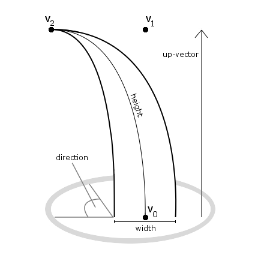
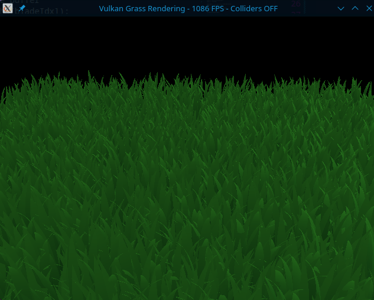
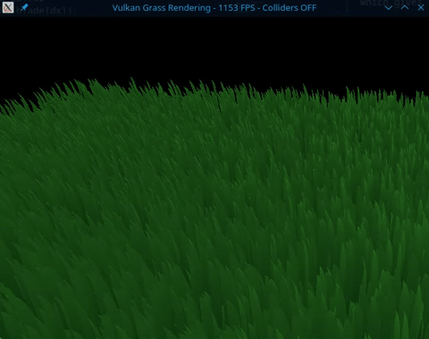
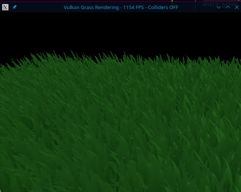
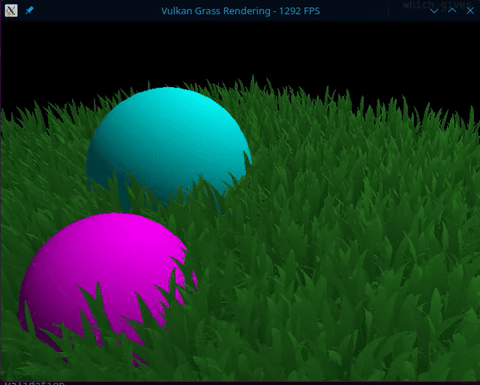

Vulkan Grass Rendering
==================================

**University of Pennsylvania, CIS 565: GPU Programming and Architecture, Project 5**

  Veer Kakar
  * [LinkedIn](www.linkedin.com/in/VeerKakar), [personal website](https://veerkakar17.github.io/PortfolioWebsite)
* Tested on: Linux Fedora 44 (Dual Boot from Windows 11 Laptop), Intel Ultra 9 275HX, NVIDIA 5070 laptop

## Overview

This is an implementation of the paper listed here: [Responsive Real-Time Grass Rendering for General 3D Scenes](https://www.cg.tuwien.ac.at/research/publications/2017/JAHRMANN-2017-RRTG/JAHRMANN-2017-RRTG-draft.pdf), which is an efficient grass renderer.
This works by representing eahc blade via 3 control points and creating a bayesian curve, seen below. 

(Credit to Responsive Real-Time Grass Rendering for General 3D Scenes for this image).

After this, it takes into account 3 different natural forces of wind, restoration, and gravity to get a natural grass look. You can see the effect of each independently below.
For restoration, this is what keeps the grass standing up, so without it everything just collapses and doesn't keep it's shape. Due to not getting any relevant renders with this disabled, the images below show the results with this still enabled.

### Gravity + Restoration

The above was taken as an image as opposed to a gif as, without wind or collisions, there scene is static after the gravity versus restoratioon force settles.

### Wind + Restoration

### Gravity + Wind + Restoration

### Collisions

Additionally, there are 2 rolling spheres in the scene which add an additional collision force to the grass, which gives it the effect of the balls "rolling over" the grass blades, which can be seen in the gif below.

## Culling

In order to render this efficiently, this paper goes in depth on 4 different culling techniques. 3 of these are implemented and highlighted below.

### Orientation Culling

This culling is based on the orientation of the grass, as they are represented as 2D objects. This means that if their width is fully parallel to the camera's view direction, they will be essentially invisible.
The prevent aliasing errors and remove unecessary processing time spent on these unnecessary blades of grass, we determine the orientation of each blade and compare it with the view direction. If the dot of their directions is greater than 0.9, they are extremely close and this grass blade is culled.

### View-Frustum Culling

This is used to cull all grass that is not entirely within the view frustum (i.e. closer than the near plane or further than the far plane). We use a simple to compute algorithm here to get a good estimate of what is within this range or not while not wasting too much processing power, and then cull what we are sure is outside of this range.

### Distance Culling

This is the biggest form of culling here, which hinges on the fact that, with dense patches of grass, further portions are less visible, so it is less necessary to render as many grass blades. If we proportionally cull blades based on distance, we can save a lot of compute while still getting a very similar look.

To do this, we look at the distance from the camera to each grass blade and, depending on how far they are, we cull a certain percentage of these grass blades. For example, we may say that for all blades between 4 and 6 units away from the camera, 40% of them are culled. These numbers were tuned in the paper to get an optimal performance inrease without significantly affecting the resulting render's appearance.

## Levels of Details

Another feature implemented here is Level of Detail. For creating the bayesian curve from the 3 control points, we use a tesselation shader which creates several vertices for this blade and arrange them according to this curve to get the correct shape. 

In order to increase performance (as blades further away will be much smaller and not require as much detail as they take up much less of the screen), we reduce the amount of tesselation (reducing the overal number of vertices created) for blades further away from the camera.

This allows us to save performance while still giving a high level of detail for the grass blades most visible to the camera.

## Performance Analaysis

The analysis below is looking at FPS count resulting from the different forms of culling. 
We first compare no culling versus each of the 3 types independently at different grass counts,
and then compare this with the effect of all culling types combined.

| Blade Count | No Culling | Orientation Culling | View-Frustum Culling | Distance Culling | All Culling | Total Speedup (%) |
|-------------|-----------:|--------------------:|---------------------:|-----------------:|------------:|------------------:|
| 2^13 (8,192) | 1325 | 1527 | 1396 | 1876 | **2055** | +55.09% |
| 2^14 (16,384) | 754 | 1015 | 985 | 1310 | **1528** | +102.65% |
| 2^15 (32,768) | 459 | 610 | 585 | 856 | **1061** | +131.15% |
| 2^16 (65,536) | 265 | 343 | 334 | 482 | **568** | +114.34% |
| 2^17 (131,072) | 161 | 179 | 174 | 281 | **362** | +124.84% |
| 2^18 (262,144) | 68 | 95 | 95 | 144 | **212** | +211.76% |
| 2^19 (524,288) | 37 | 49 | 47 | 73 | **93** | +151.35% |
| 2^20 (1,048,576) | 20 | 25 | 22 | 38 | **44** | +120.00% |

As we see here, compared to no culling, in heavy scenes we saw up to a 211% increase, with the biggest scene giving us a 120% increase with all culling.
Of each culling method, Distance Culling had the biggest effect, then Orientation Culling and finally View-Frustum Culling.

This makes sense with this scene as, with increasing distance, this culling removes the most grass and decreases load the most. 
For Orientation Culling, all orientations are generated at random. This means that, compared to distance where many will be guanranteed to be far enough away, a much smaller proportional amount will be very close in orientation to the camera and be culled. However, with enough grass blades, this does end up being substantial.
For View Frustum culling, as we had a very small scene of grass and most of the grass fit within the range of the camera, this ended up culling the least and had the smallest effect. However, in bigger scenes where the grass spreads out more, this could have a much greater effect.